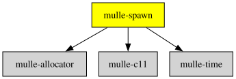

# mulle-spawn

#### 🛸 Run a program, keep its output, outlive it if need be

The two cross-platform calls for getting a second process, without `fork()`,
without `system()` and without a shell: one that **runs a program** and hands you
what it printed under a deadline, and one that **starts a program and keeps it**,
so you can talk to it and stop it when you are done.

mulle-spawn exists because `fork()` is the one thing you cannot abstract over a
Windows and a POSIX build, and because the interesting cases are not "run a
program" but "run a program that may never come back". `CreateProcess` on
Windows and `fork`/`execvp` on POSIX are the two implementations; the API above
them is the same on both, down to which byte reaches you.

The two calls are the same spawn minus the waiting, which is the whole
difference between them:

| | `mulle_spawn_run` | `mulle_spawn_open` |
|---|---|---|
| comes back | when the child is done, or its deadline passed | as soon as the child runs |
| `stdout` | captured into a buffer for you | a descriptor, for you to read |
| what you hold | a fate: exit code, output | a handle: descriptors and a pid |
| ends with | nothing to clean up but the buffer | `terminate`/`close`, which reap |

It is not a shell. There is no globbing, no redirection and no `PATH` search
beyond what the platform does for you: `argv` is passed through as the words you
gave, which is all a program needs and all it should assume.


| Release Version                                       | AI Documentation
|-------------------------------------------------------|------------------
|  | [DeepWiki for mulle-spawn](https://deepwiki.com/mulle-core/mulle-spawn)


## API Guide

### Run a program and read what it said

```c
#include <mulle-spawn/mulle-spawn.h>

struct mulle_spawn_result   r;
char                        *argv[ 3];
int                         rval;

argv[ 0] = "/usr/bin/uname";
argv[ 1] = "-s";
argv[ 2] = NULL;

mulle_spawn_result_init( &r, NULL);          // NULL is the default allocator
rval = mulle_spawn_run( argv, 5.0, &r);

if( rval == 0)
{
   // a child was created, its fate is in r
   printf( "status %d, exit %d, said <%.*s>\n",
           r.status, r.exit_code, (int) r.length, r.output ? r.output : "");
}
// -1 means nothing ran at all: no such program, or no process to be had
// r.status is mulle_spawn_failed then

mulle_spawn_result_done( &r);                // releases r.output
```

### Run yourself again

The pattern this library was extracted for: a program that wants a *fresh
process* of itself, one that shares nothing, so a crash or a hang cannot take
the caller with it.

```c
char   self[ 1024];
char   *argv[ 3];

if( mulle_spawn_get_executable_path( self, sizeof( self)) > 0)
{
   argv[ 0] = self;
   argv[ 1] = "--child";
   argv[ 2] = NULL;

   mulle_spawn_result_init( &r, NULL);
   mulle_spawn_run( argv, MULLE_SPAWN_NO_TIMEOUT, &r);
   mulle_spawn_result_done( &r);
}
```

### A child that may not come back

```c
// one second, or not at all: TerminateProcess on Windows, SIGKILL on POSIX
mulle_spawn_result_init( &r, NULL);
mulle_spawn_run( argv, 1.0, &r);

if( r.status == mulle_spawn_terminated)
{
   // it was killed. Whatever it printed before that is still in r.output, and
   // that is usually the answer you were waiting for.
}
```

### Start a program and keep talking to it

A server, a filter, a REPL: anything you intend to converse with wants the
spawn, not the result. `open` gives back its standard streams as descriptors and
the child stays alive; `wait` is how you find out that it stopped.

```c
struct mulle_spawn_handle   h;
char                        buf[ 256];

// argv, then the fate of the child's stdin, stdout and stderr, in that order
if( mulle_spawn_open( &h, argv, MULLE_SPAWN_PIPE, MULLE_SPAWN_PIPE,
                      MULLE_SPAWN_INHERIT) == 0)
{
   write( h.out, "PING\r\n", 6);            // h.out is binary; _write on Windows
   n = read( h.in, buf, sizeof( buf));

   mulle_spawn_terminate( &h);               // SIGTERM / TerminateProcess
   mulle_spawn_wait( &h, 5.0, &r);           // reap it; 0 if it is still running
   mulle_spawn_close( &h, NULL);             // always leaves nothing behind
}
```

`MULLE_SPAWN_PIPE` puts a descriptor in the handle, `MULLE_SPAWN_INHERIT`
leaves the parent's own stream alone, `MULLE_SPAWN_DISCARD` sends it to the
null device, and `MULLE_SPAWN_DESCRIPTOR` gives the child one of yours. Note
which way round the names read: `in` is what the child *reads*, `out` is what
it *writes*, which is the child's point of view.

A handle deliberately does not capture. There is one reader for a pipe and here
you are it, so `wait` and `close` report the child's fate and leave `output`
NULL -- the stream was yours.

`open` returns 0 only once the program is actually running, so you never have to
tell "cannot start it" from "it started and died at once" by reading a pipe that
closed. `-1` means no process was created, nothing is left open, and on POSIX
`errno` says why. (The one thing this cannot cover is a Windows process that
dies a moment later for want of a DLL -- a failure `CreateProcessW` does not
report.) A program that cannot be *executed* is refused on both platforms.

`close` is safe on a handle that was never opened, and `terminate` does not
wait, so a child that tidies up first gets its chance: terminate, wait, close.
If you close a descriptor yourself, set the field to `-1` so `close` does not
close it twice -- descriptor numbers get reused.

### Giving the child an environment

`mulle_spawn_open` starts a child that inherits your environment, because that
is what every caller has wanted so far. When one does not, the same call takes
a description of the launch instead of the three modes:

```c
struct mulle_spawn_options   options;
char                         *env[ 2];

env[ 0] = "PATH=/usr/bin:/bin";
env[ 1] = NULL;

mulle_spawn_options_init( &options);
options.env      = env;
options.out_mode = MULLE_SPAWN_PIPE;

mulle_spawn_open_with_options( &h, argv, &options);
```

`env` is `execve`'s `envp`, NULL terminated, and it *replaces* your environment
rather than being merged into it: `NULL` means "mine", `{ NULL }` means "none at
all". A replaced `PATH` is also the one `argv[ 0]` is looked up in, so a child
meant to run under a different environment is found the way that environment
would find it. The array is not copied -- it has to stay valid until `open`
returns, which is when the child receives it.

### The directory the child runs in

The same struct names where the child starts:

```c
options.directory = "/tmp";
```

`NULL` is the directory it would have inherited. A named one is entered before
the program is looked up, so a relative `argv[ 0]` is resolved against it, and
the rest of this call's arguments are unaffected -- `mulle_spawn_open_with_options`
never changes *your* working directory, only the child's.

A directory that is not there fails the launch, rather than starting the
program in the wrong place: two children that ran in different directories look
exactly alike afterwards, which is the failure this field exists to prevent.
The complaint is the parent's, before anything is created, on POSIX with
`errno` saying why (`ENOENT`, `ENOTDIR`, `EACCES`) -- a child that choked on the
directory and exited would report the same thing as a child that ran and
returned 1. On Windows `CreateProcessW` refuses it itself through
`lpCurrentDirectory`.

### Giving the child a descriptor of your own

A pipe you did not make is the fourth mode, and it is the one `NSPipe` and file
redirection need: `MULLE_SPAWN_PIPE` can only ever create a *new* pipe and hand
you an end of it, while a file, a socket, or a pipe somebody else made is
`MULLE_SPAWN_DESCRIPTOR`, which gives the child the descriptor named in the same
struct.

```c
int   fds[ 2];

pipe( fds);                            /* or _pipe( fds, 4096, _O_BINARY) */

mulle_spawn_options_init( &options);
options.out_mode       = MULLE_SPAWN_DESCRIPTOR;
options.out_descriptor = fds[ 1];

mulle_spawn_open_with_options( &h, argv, &options);
mulle_spawn_wait( &h, 5.0, NULL);
mulle_spawn_close( &h, NULL);          /* does not close fds[ 1] */

n = read( fds[ 0], buf, sizeof( buf));
```

The descriptor stays yours. The child is given a copy of it, the handle does not
take it over, and neither `close` nor `detach` closes it -- so a caller that
goes on reading and writing the same file afterwards is not surprised. It is
also why the handle's own `in`, `out` and `err` stay -1 in that mode: nothing was
made for you, so there is nothing for the handle to own.

Waiting before closing is not a formality here. `close` terminates a child that
is still running, and a child that has been killed never flushes what it
printed -- so the reader above would find an empty pipe and blame the launch.

A descriptor that is not open fails the launch rather than starting a child that
dies on its first write: on POSIX it is checked in the parent and `errno` is
`EBADF`, and on Windows there is no inheritable handle to pass on and
`CreateProcessW` is refused.

### A child that outlives the handle

`close` is the right verb for a helper you started and are done with, and the
wrong one for a child that is meant to outlive you -- a daemon, or a relauncher
that starts something and exits. `detach` does neither of the two things close
does: it does not terminate the child and it does not wait for it.

```c
unsigned long   pid;

pid = h.pid;                 /* read it first: detach empties the handle */
mulle_spawn_detach( &h);     /* descriptors closed, child neither killed nor reaped */
```

The descriptors this handle held are closed, so nothing of yours is left in the
child's streams, and the child goes on running. What is given up is its fate:
nothing here will ever wait for it again, so on POSIX it becomes an orphan for
init to reap, and on Windows its exit code is never collected by anybody.
Afterwards `wait`, `terminate` and `close` on that handle have nothing to act on
and report it as an error rather than pretending otherwise.

`struct mulle_spawn_options` is the shape this grows in: `env`, `directory` and
a descriptor per stream today, and the rest of what a launch can be set to as it
arrives. A zeroed struct *is* the default, which is
why `mulle_spawn_open( h, argv, in_mode, out_mode, err_mode)` is
exactly this call with a zeroed struct and those three modes.

Output and termination are independent on purpose. A child that printed
something and *then* hung leaves that output in `output` with
`mulle_spawn_terminated` in `status`; a caller that asked a question usually
wants the output, a caller measuring liveness usually wants the status.


## What you get, and what you do not

| | |
|---|---|
| `stdout` | **replaced by a pipe and captured**. It is bytes, NUL terminated for convenience, with `length` as the truth. |
| `stdin`, `stderr` | **inherited unchanged**. `stderr` is left alone deliberately: that is where the child's complaints belong, and where your own diagnostics must survive it. |
| deadline | unconditional. There is no cooperative shutdown, because the cases worth covering are the ones that cannot cooperate. |
| `argv` | passed through as written. On Windows it is quoted for `CreateProcessW`, so paths with spaces work. |

Two platform differences are reconciled rather than exposed:

* **The exit of a program that cannot be run.** POSIX reports it as the child
  exiting 127, the convention a shell uses, and says so on `stderr`. Windows
  has no such exit code to give, so the same situation arrives as
  `mulle_spawn_run` returning -1 with `mulle_spawn_failed`. Check the return
  value, not the exit code, if you care.
* **Newlines.** A Windows CRT writes `\r\n` for every `\n` the program wrote,
  and that is what arrives down the pipe. mulle-spawn removes the `\r` of a
  `\r\n` pair -- the exact inverse of that translation and nothing else -- so a
  child that printed `a\nb\n` reads as `a\nb\n` on every platform. A lone `\r`
  is left alone, and a program that deliberately wrote `\r\n` gets `\r\n` back
  rather than `\r\r\n`.

`signal_number` is POSIX by definition and stays 0 wherever there are no
signals. On Windows a crashing child is a non-zero `exit_code`, which is what
the platform actually knows.


## Documentation & Guides

* [API Summary](asset/dox/api/toc)


### You are here




## Add

mulle-spawn is a component of the [mulle-core](//github.com/mulle-core/mulle-core)
library. So in your code include the mulle-core umbrella header:

``` c
#include <mulle-core/mulle-core.h>
```

### Add mulle-core to a cmake and git project

``` bash
git submodule add https://github.com/mulle-core/mulle-core.git mulle-core
```

Add this to your `CMakeLists.txt`:

``` cmake
add_subdirectory( mulle-core)
target_link_libraries( ${PROJECT_NAME} PRIVATE mulle-core)
```


### Add mulle-core to a mulle-sde project

``` sh
mulle-sde add github:mulle-core/mulle-core
```

### Embed mulle-spawn with clib

``` sh
clib install --out src mulle-core/mulle-spawn
```

Append `src` to your include path (e.g. add `-isystem src`  to your `CFLAGS`)
and compile all the sources that were downloaded.


## Install

Use [mulle-sde](//github.com/mulle-sde) to build and install mulle-spawn and all dependencies:

``` sh
mulle-sde install --prefix /usr/local \
   https://github.com/mulle-core/mulle-spawn/archive/latest.tar.gz
```

### Legacy Installation

Install the requirements:

| Requirements                                 | Description
|----------------------------------------------|-----------------------
| [mulle-allocator](https://github.com/mulle-c/mulle-allocator)             | 🔄 Flexible C memory allocation scheme
| [mulle-c11](https://github.com/mulle-c/mulle-c11)             | 🍰 Useful C11 macros for mulle projects
| [mulle-time](https://github.com/mulle-core/mulle-time)             | 🕰 Time handling

Download the latest [tar](https://github.com/mulle-core/mulle-spawn/archive/refs/tags/latest.tar.gz) or [zip](https://github.com/mulle-core/mulle-spawn/archive/refs/tags/latest.zip) archive and unpack it.

Install **mulle-spawn** into `/usr/local` with [cmake](https://cmake.org):

``` sh
PREFIX_DIR="/usr/local"
cmake -B build                               \
      -DMULLE_SDK_PATH="${PREFIX_DIR}"       \
      -DCMAKE_INSTALL_PREFIX="${PREFIX_DIR}" \
      -DCMAKE_PREFIX_PATH="${PREFIX_DIR}"    \
      -DCMAKE_BUILD_TYPE=Release &&
cmake --build build --config Release &&
cmake --install build --config Release
```


## Author

[Nat!](https://mulle-kybernetik.com/weblog) for Mulle kybernetiK
